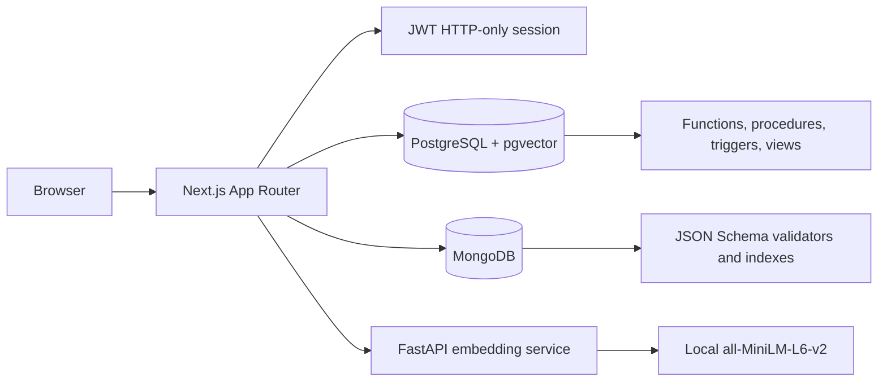

# MediConnect Architecture

## Component diagram

## Request flows

### Authentication

1. The browser submits credentials to `/api/auth/login`.
2. Next.js validates the body and queries the users table.
3. Argon2id verifies the stored password hash.
4. A signed JWT is written to an HTTP-only `mc_session` cookie.
5. `requireRole` verifies the session and role for protected routes.

### Appointment booking

1. The patient loads verified doctors and available future slots.
2. The API calls PostgreSQL `book_appointment`.
3. The function locks the patient row and slot row in a fixed order.
4. Constraints and triggers prevent conflicts and synchronize slot status.
5. The appointment is returned only after the transaction succeeds.

### Case submission saga

1. The patient submits validated title, narrative, symptoms, severity, and
   consent.
2. Next.js requests a local 384-dimensional embedding from FastAPI.
3. The MongoDB `case_details` document is inserted.
4. PostgreSQL commits the case header and pgvector row together.
5. If PostgreSQL fails, the MongoDB document is deleted.
6. If embedding generation fails, no database writes are attempted.

### Semantic matching

1. A doctor requests `/api/cases/:id/matches`.
2. PostgreSQL verifies that the case is attached to that doctor's active
   appointment and that an embedding exists.
3. `find_similar_cases` filters for consented resolved/closed cases.
4. Cosine similarity ranks the results and writes `case_match_log`.
5. The response contains only matched case IDs, specialization, and scores.

## Trust boundaries

- Browser to Next.js: untrusted input; use Zod and session checks.
- Next.js to databases: parameterized SQL and restricted app role.
- Next.js to embedding service: shared local API key and dimension validation.
- PostgreSQL to MongoDB: plain UUID links with saga cleanup and consistency
  verification.

