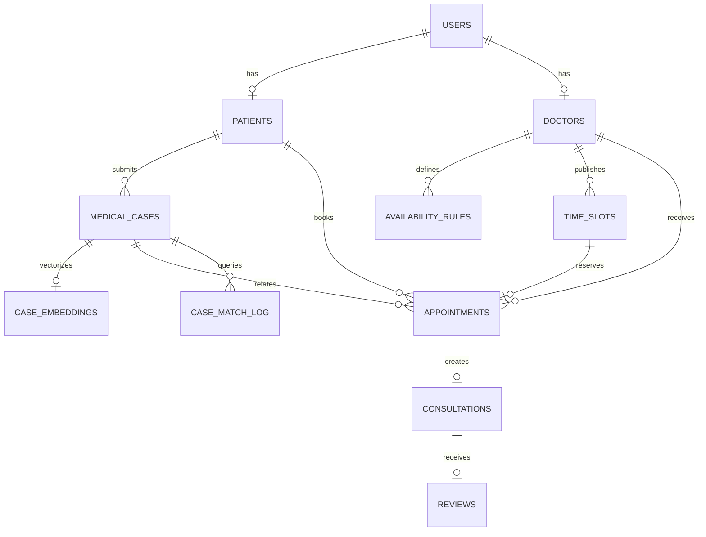

# MediConnect Database Schema

## PostgreSQL entities

## Core tables

| Area | Tables | Purpose |
|---|---|---|
| Identity | `users`, `patients`, `doctors` | Accounts and role profiles |
| Scheduling | `specializations`, `availability_rules`, `time_slots` | Doctor directory and slots |
| Clinical workflow | `medical_cases`, `appointments`, `consultations`, `reviews` | Relational workflow metadata |
| Search/audit | `case_embeddings`, `case_match_log`, `audit_log` | Similarity and traceability |

## MongoDB collections

| Collection | Contents | Privacy rule |
|---|---|---|
| `case_details` | Narrative, symptoms, synthetic clinical details | Patient identity is not stored here |
| `consultation_notes` | Flexible doctor notes | Linked by consultation ID |
| `notifications` | In-app notifications | Linked by user UUID |

## Integrity mechanisms

- Foreign keys and composite foreign keys preserve ownership.
- Partial unique index allows only one active appointment per slot.
- Exclusion constraints block overlapping slot ranges.
- Triggers synchronize slot status and audit changes.
- Status transition triggers prevent illegal appointment changes.
- `DRAFT_INCOMPLETE` represents an intentionally recoverable cross-store
  failure state.
- HNSW vector index supports cosine similarity.

Migration source files are in
[database/postgres/migrations](../database/postgres/migrations).

